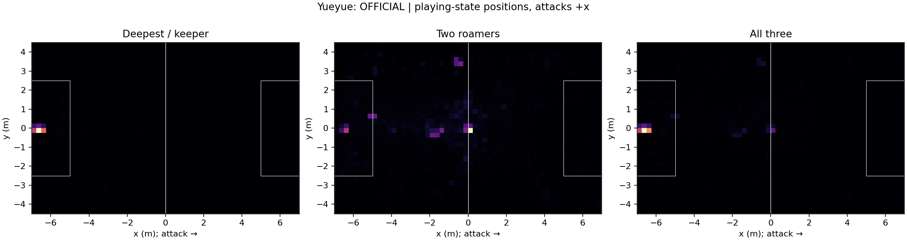
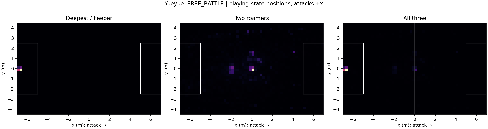
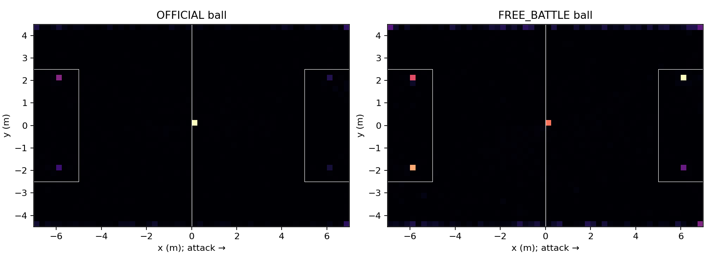

# How 月月 plays and wins — Booster Studio 3v3 S1

## Executive finding

**The repeatable structure is a very deep goalkeeper plus two mobile field robots—not three equal ball-chasers.** In the 20 available S1 replays, the deepest robot averages x=−6.05 m, spends 89.94% of playing samples in the operational own-box region and moves only 46 m/game versus 187 m for each roamer. In the latest 20 arena matches, the structure is even clearer: goalkeeper x=−6.63 m, 97.27% in-box, 34 m/game. The keeper number is **not fixed throughout S1** (players 1/2/3: 9/5/6 matches); recent arena keeper is #3 in 17/20, #2 in two, #1 in one. Do not infer roles from global player-number averages alone.

The champion won all seven group/knockout games while conceding in every one: 37–21 aggregate. This is successful **outscoring with deep insurance**, not an impenetrable clean-sheet machine. Robot coordinates and proximity do not prove passing intent or shooting quality.

## 1. Match record

Input snapshot: 371 unique match records, scheduled 2026-07-19 through 2026-11-18 (UTC). One failed arena start (`52229bc2-4e1a-46a7-ae8c-63d4a214b66e`, no perspective/result) is excluded: **370 completed results**. Arena means `FREE_BATTLE`, not tournament practice inferred from names. Recent means latest scheduled timestamps, not list position.

| Scope | N | W | D | L | GF | GA | GF_game | GA_game | clean_sheets | fouls_game | opp_fouls_game |
| --- | --- | --- | --- | --- | --- | --- | --- | --- | --- | --- | --- |
| All | 370.00 | 294.00 | 35.00 | 41.00 | 1471.00 | 614.00 | 3.98 | 1.66 | 95.00 | 1.56 | 2.29 |
| OFFICIAL S1 | 21.00 | 16.00 | 1.00 | 4.00 | 80.00 | 51.00 | 3.81 | 2.43 | 2.00 | 1.57 | 1.95 |
| Arena | 349.00 | 278.00 | 34.00 | 37.00 | 1391.00 | 563.00 | 3.99 | 1.61 | 93.00 | 1.56 | 2.32 |
| S1 GROUP | 3.00 | 3.00 | 0.00 | 0.00 | 14.00 | 9.00 | 4.67 | 3.00 | 0.00 | 2.00 | 1.33 |
| S1 KNOCKOUT | 4.00 | 4.00 | 0.00 | 0.00 | 23.00 | 12.00 | 5.75 | 3.00 | 0.00 | 1.25 | 4.00 |
| S1 QUALIFY | 2.00 | 1.00 | 0.00 | 1.00 | 9.00 | 9.00 | 4.50 | 4.50 | 0.00 | 0.50 | 0.00 |
| S1 SWISS | 12.00 | 8.00 | 1.00 | 3.00 | 34.00 | 21.00 | 2.83 | 1.75 | 2.00 | 1.75 | 1.75 |
| Arena recent 10 | 10.00 | 6.00 | 1.00 | 3.00 | 25.00 | 16.00 | 2.50 | 1.60 | 2.00 | 3.10 | 1.60 |
| Arena recent 20 | 20.00 | 14.00 | 2.00 | 4.00 | 54.00 | 21.00 | 2.70 | 1.05 | 8.00 | 3.15 | 1.75 |
| Arena recent 50 | 50.00 | 31.00 | 7.00 | 12.00 | 116.00 | 60.00 | 2.32 | 1.20 | 15.00 | 2.84 | 1.98 |

All completed-game win rate 79.46%; S1 76.19%; arena 79.66%. Recent 20 arena: 70%, down from the lifetime arena rate, but goals conceded/game are also lower. Different opponents and July-versus-November builds prevent causal claims about improvement.

### S1 opponents (all)
| opponent | N | W | D | L | GF | GA |
| --- | --- | --- | --- | --- | --- | --- |
| 嘻嘻 | 1.00 | 1.00 | 0.00 | 0.00 | 3.00 | 2.00 |
| MIracle | 1.00 | 1.00 | 0.00 | 0.00 | 5.00 | 2.00 |
| Kings - UFG - Brazil | 1.00 | 1.00 | 0.00 | 0.00 | 2.00 | 0.00 |
| 没有人比我更懂足球 | 2.00 | 1.00 | 1.00 | 0.00 | 9.00 | 8.00 |
| 轻轻敲醒沉睡的心灵 | 1.00 | 0.00 | 0.00 | 1.00 | 2.00 | 3.00 |
| Vario FC | 1.00 | 1.00 | 0.00 | 0.00 | 2.00 | 1.00 |
| fjy | 1.00 | 1.00 | 0.00 | 0.00 | 2.00 | 1.00 |
| SUI | 1.00 | 0.00 | 0.00 | 1.00 | 0.00 | 3.00 |
| Three Body | 1.00 | 1.00 | 0.00 | 0.00 | 4.00 | 1.00 |
| CNU_lynx | 1.00 | 0.00 | 0.00 | 1.00 | 2.00 | 3.00 |
| 王 | 1.00 | 1.00 | 0.00 | 0.00 | 9.00 | 3.00 |
| 新手小白勇闯足球 | 1.00 | 1.00 | 0.00 | 0.00 | 3.00 | 0.00 |
| TanngLong | 1.00 | 1.00 | 0.00 | 0.00 | 4.00 | 2.00 |
| 夜神市区 | 1.00 | 1.00 | 0.00 | 0.00 | 3.00 | 1.00 |
| hjy | 1.00 | 1.00 | 0.00 | 0.00 | 3.00 | 2.00 |
| 泡泡工坊 | 1.00 | 1.00 | 0.00 | 0.00 | 6.00 | 1.00 |
| 峰城附轻音同好会主唱小木曾雪菜 | 1.00 | 1.00 | 0.00 | 0.00 | 6.00 | 4.00 |
| 响响 | 1.00 | 1.00 | 0.00 | 0.00 | 6.00 | 5.00 |
| AI | 2.00 | 1.00 | 0.00 | 1.00 | 9.00 | 9.00 |

S1 losses: AI 3–5 (qualification), CNU_lynx 2–3, SUI 0–3, 轻轻敲醒沉睡的心灵 2–3. All four loss replays are available. Final listed knockout win: MIracle 5–2; other knockout wins: hjy 3–2, 王 9–3, 响响 6–5.

### Arena: ten most frequent opponents
| opponent | N | W | D | L | GF | GA |
| --- | --- | --- | --- | --- | --- | --- |
| No.1 | 19.00 | 18.00 | 1.00 | 0.00 | 85.00 | 31.00 |
| frtyhu | 18.00 | 18.00 | 0.00 | 0.00 | 98.00 | 5.00 |
| Robonaldo(Mike) | 16.00 | 3.00 | 4.00 | 9.00 | 85.00 | 96.00 |
| 响响 | 16.00 | 7.00 | 3.00 | 6.00 | 70.00 | 67.00 |
| 000M | 15.00 | 15.00 | 0.00 | 0.00 | 65.00 | 19.00 |
| 天凯 | 14.00 | 14.00 | 0.00 | 0.00 | 89.00 | 12.00 |
| 体元 | 12.00 | 10.00 | 1.00 | 1.00 | 62.00 | 17.00 |
| Evilbots | 8.00 | 8.00 | 0.00 | 0.00 | 25.00 | 12.00 |
| 北京市第二中学分校刘奕辰 | 7.00 | 3.00 | 2.00 | 2.00 | 22.00 | 22.00 |
| 老大 | 6.00 | 6.00 | 0.00 | 0.00 | 25.00 | 4.00 |

Robonaldo(Mike) is a genuine adverse head-to-head (3–4–9, 85–96), unlike the heavily farmed unbeaten opponents. Full opponent/player-ID splits, including all opponents beaten or lost to, are in `opponents.csv`; name collisions are not merged across player IDs.

## 2. Robot roles and physical behavior

Positions/distances in metres; percentages 0–100; distance is sampled horizontal travel per match. Entries are equal-match means over playing-state samples, not a pooled 40-match time average. `closest` is share of time closest **among that team's three robots**. `own_box` is x≤−5 and |y|≤2.5 (an explicitly operational region, not independently verified official penalty-box geometry). Own goal reference is (−7,0). Both teams are normalized to their **own** attack +x; this is a 180° rotation, including y.

### Per player number, champion
| source | player | mean_x | std_x | mean_y | std_y | own_half | own_box | goal_distance | ball_distance | closest | distance | fallen_pct | fouls |
| --- | --- | --- | --- | --- | --- | --- | --- | --- | --- | --- | --- | --- | --- |
| FREE_BATTLE | 1 | -1.31 | 2.70 | 0.82 | 2.32 | 65.24 | 10.47 | 6.36 | 4.55 | 43.76 | 189.79 | 2.20 | 1.65 |
| FREE_BATTLE | 2 | -1.27 | 2.61 | 0.44 | 1.91 | 60.23 | 13.95 | 6.22 | 4.71 | 39.25 | 179.27 | 1.46 | 1.20 |
| FREE_BATTLE | 3 | -5.85 | 0.82 | 0.03 | 0.55 | 94.93 | 83.27 | 1.29 | 7.68 | 16.99 | 62.49 | 0.50 | 0.30 |
| OFFICIAL | 1 | -3.77 | 2.29 | 0.29 | 1.34 | 82.28 | 50.72 | 3.55 | 5.18 | 33.03 | 113.23 | 0.56 | 0.55 |
| OFFICIAL | 2 | -2.56 | 2.66 | 0.48 | 1.71 | 76.24 | 30.75 | 4.89 | 4.39 | 36.29 | 159.70 | 0.69 | 0.60 |
| OFFICIAL | 3 | -2.76 | 2.21 | 0.38 | 1.61 | 78.06 | 36.43 | 4.63 | 4.83 | 30.68 | 147.74 | 1.01 | 0.50 |

`std_x/std_y` are mean within-match positional standard deviations, not between-match spread. Because keepers change number, the following role-aligned comparison is the tactical baseline; role is assigned to the deepest mean-x robot in each match, with the other two called roamers. This classification always selects one deepest player, so its existence alone does not demonstrate a fixed goalkeeper: **17/20 S1 deepest players have >85% box occupancy**, versus all 20 recent arena keepers (>92%). The early two qualification matches and one Swiss match are less cleanly separated. Roamers have similar ball-nearness shares (~43% each); no stable, number-specific striker/support hierarchy is established.

### Role-aligned champion and opponent baseline
| source | team | role | mean_x | mean_y | own_half | own_box | goal_distance | ball_distance | closest | distance | fallen_pct | fouls |
| --- | --- | --- | --- | --- | --- | --- | --- | --- | --- | --- | --- | --- |
| FREE_BATTLE | champion | deepest/keeper | -6.63 | -0.05 | 100.00 | 97.27 | 0.41 | 8.11 | 13.44 | 33.85 | 0.17 | 0.10 |
| FREE_BATTLE | champion | roamer | -0.90 | 0.67 | 60.20 | 5.21 | 6.73 | 4.42 | 43.28 | 198.85 | 1.99 | 1.52 |
| FREE_BATTLE | opponent | deepest/keeper | -4.31 | 0.10 | 86.94 | 60.83 | 3.17 | 5.93 | 27.41 | 124.98 | 0.61 | 0.50 |
| FREE_BATTLE | opponent | roamer | -1.71 | 0.26 | 66.79 | 22.20 | 5.83 | 4.70 | 36.29 | 180.78 | 1.02 | 0.62 |
| OFFICIAL | champion | deepest/keeper | -6.05 | 0.06 | 97.82 | 89.94 | 1.05 | 6.72 | 14.27 | 46.10 | 0.25 | 0.20 |
| OFFICIAL | champion | roamer | -1.52 | 0.55 | 69.38 | 13.99 | 6.01 | 3.84 | 42.87 | 187.29 | 1.01 | 0.72 |
| OFFICIAL | opponent | deepest/keeper | -4.89 | 0.18 | 90.96 | 72.74 | 2.61 | 6.72 | 21.11 | 100.23 | 0.34 | 0.80 |
| OFFICIAL | opponent | roamer | -1.54 | 0.43 | 69.72 | 15.78 | 5.99 | 4.37 | 39.45 | 174.44 | 1.07 | 0.62 |

Opponent 'keeper' means deepest player even when that opponent has no dedicated keeper. S1 opponent deepest players spend only 72.74% in-box; recent arena opponents 60.83%, compared with 月月 89.94%/97.27%. The champion's roamers are nearer the ball than S1 opponent roamers (3.84 vs 4.37 m), but recent arena roamers average 4.42 vs 4.70 m.

Falls: `upDot<0.45`; episodes are sampled upright→fallen transitions during play, not authoritative referee falls. S1: champion 39 episodes versus opponents 37; recent arena 52 versus 45. Low-upDot sample shares and referee foul counts are separate measurements. Of 月月's S1 33 fouls, 16 were `fallenRobot`, 6 `illegalPosition`, 5 `inactiveRobot`, 5 defender set-play interference, 1 `stopped_motion`. Recent arena 63: 53 fallen, 6 set-play interference, 4 illegal position. Thus **fall/recovery discipline is the strongest current exploit opportunity**, not evidence of deliberate physical fouling. Full opponent and player-number metrics: `robots.csv`, `robot_summary.csv`, `fouls_by_reason.csv`.

## 3. Shape, territory and proximity possession

Line height = mean x of all three; width/depth = max-minus-min y/x; spread = mean pairwise teammate distance. Ball thirds use x=±7/3. Values below use each team's own attacking orientation. Exact center-line samples belong to neither half, so opposing own-half percentages need not sum to 100.

| source | team | line_height | width | depth | spread | closest_proxy | ball_mean_x | ball_own_half | ball_attack_third | ball_defense_third |
| --- | --- | --- | --- | --- | --- | --- | --- | --- | --- | --- |
| FREE_BATTLE | champion | -2.81 | 2.92 | 7.01 | 5.48 | 46.57 | 0.40 | 45.76 | 37.87 | 30.06 |
| FREE_BATTLE | opponent | -2.58 | 2.76 | 6.25 | 4.93 | 53.43 | -0.40 | 49.66 | 30.06 | 37.87 |
| OFFICIAL | champion | -3.03 | 2.63 | 6.35 | 4.98 | 53.14 | -0.42 | 48.57 | 27.21 | 35.84 |
| OFFICIAL | opponent | -2.66 | 2.68 | 5.91 | 4.74 | 46.86 | 0.42 | 39.06 | 35.84 | 27.21 |

S1 has a deeper champion line (−3.03 vs −2.66 m), similar width, and greater depth: consistent with one robot held far behind two roamers. Ball territory is not dominant: 35.84% in the champion defensive third vs 27.21% attacking third. Recent arena is more attack-tilted (37.87% attacking-third vs 30.06% defensive-third), with a more spread-out longitudinal shape.

Possession proxy = which team's nearest robot is nearer to the ball. It is **not controlled possession**: a goalmouth defender can win this proxy while under attack. S1 champion 53.14%, arena 46.57%; the champion can win without winning proximity time.

### Winning versus losing (outcomes always from 月月's perspective)
| source | outcome | N | line_x | width | spread | closest_pct | ball_x | ball_def_third_pct |
| --- | --- | --- | --- | --- | --- | --- | --- | --- |
| FREE_BATTLE | draw | 2 | -3.22 | 3.06 | 5.14 | 44.25 | -0.33 | 33.98 |
| FREE_BATTLE | loss | 4 | -3.08 | 3.18 | 5.36 | 55.23 | -0.69 | 39.43 |
| FREE_BATTLE | win | 14 | -2.67 | 2.83 | 5.56 | 44.43 | 0.82 | 26.82 |
| OFFICIAL | draw | 1 | -3.31 | 2.94 | 5.18 | 65.35 | -1.50 | 43.02 |
| OFFICIAL | loss | 4 | -2.79 | 2.38 | 4.79 | 55.09 | -0.23 | 35.73 |
| OFFICIAL | win | 15 | -3.08 | 2.68 | 5.01 | 51.81 | -0.40 | 35.39 |

S1 win/loss shape differences are small (15 available wins vs four losses); no reliable causal formation adjustment follows. Arena wins put the ball much farther forward (+0.82 vs −0.69 m) and reduce defensive-third exposure (26.82% vs 39.43%). Yet losses have *higher* proximity share (55.23 vs 44.43%), a direct warning not to optimize the proxy as possession. Draws are included for completeness; only one S1 and two arena draws.

## 4. Goals: timing and the preceding five seconds

20 S1 replay scorelines reconcile to **77 scored/51 conceded** (the unavailable 3–0 win accounts for the missing three scored goals). Arena: 54/21. Replay goal events match every available match's total score.

Goals by match-clock elapsed minutes (8+ includes any extra time; this is not replay wall time):
| source | kind | 0–2 | 2–4 | 4–6 | 6–8 | 8+ |
| --- | --- | --- | --- | --- | --- | --- |
| FREE_BATTLE | conceded | 4 | 4 | 4 | 3 | 6 |
| FREE_BATTLE | scored | 6 | 13 | 7 | 15 | 13 |
| OFFICIAL | conceded | 9 | 10 | 13 | 10 | 9 |
| OFFICIAL | scored | 13 | 16 | 19 | 17 | 12 |

No obvious S1 late-goal surge: scored distribution 13/16/19/17/12, conceded 9/10/13/10/9. Recent arena scoring is stronger after minute 6 (28/54), but this is descriptive, not evidence of stamina adaptation.

Five-second ball-trajectory starts, champion attack +x; central = |y|<1.5 m:
| source | kind | N | start_x | abs_start_y | own_half_starts | central_starts |
| --- | --- | --- | --- | --- | --- | --- |
| FREE_BATTLE | conceded | 21 | -2.98 | 1.34 | 19 | 14 |
| FREE_BATTLE | scored | 54 | 1.68 | 1.52 | 15 | 29 |
| OFFICIAL | conceded | 51 | -2.61 | 1.62 | 37 | 25 |
| OFFICIAL | scored | 77 | 0.04 | 0.98 | 17 | 52 |

S1 scoring starts close to midfield on average, with 52/77 central-lane starts and 17/77 starting in its own half. S1 concessions begin at mean x=−2.61; recent concessions −2.98. Recent scoring starts farther forward (+1.68). These are **five-second windows**, not shot origins or complete attacks. `goals.csv` records start/end x,y and last nearby robot; `goal_trajectories.csv` preserves each sampled x,y point. Last-near uses any robot within 0.65 m in the window, latest time then closest distance. It is not a scorer/assist label: many scoring windows end with an opposing keeper nearby. S1 scored windows: last-near champion/opponent/missing = 37/37/3; arena scored 19/35/0. Latest logged `ball_touch` actor, when present in the window, is separately recorded.

## Implications for our strategy: 1 goalkeeper + 2 roaming attackers

1. **Keep our goalkeeper genuinely deep and centrally disciplined.** Benchmark x≈−6 to −6.6, >90% in the operational box, not necessarily a hard target; avoid blindly following the ball out. Their persistent keeper means we should expect rebounds and a second save, not an empty net.
2. **Use two coordinated roamers, not a permanently numbered striker/support.** Choose the challenger dynamically; the other provides a lateral/second-ball option and transition cover. 月月's role structure is stable but the assigned number is not. These are recommended responses, not measured proof that 月月 passes in combinations.
3. **Attack in two actions.** Seek a wide approach/cutback or second-ball finish to displace a deep central keeper, rather than merely crowding the nearest-ball contest. Test this against a baseline; trajectories here do not establish a wide-shot success rate.
4. **Protect the central recovery lane.** Most S1 five-second scoring windows begin centrally; keep the non-chasing roamer between ball and our goal until possession is secure. Arena loss territory is a better alarm than proximity share: track defensive-third exposure and shots/concessions, not only who is closest.
5. **Exploit falls safely and fix our own recovery first.** Recent 月月 fallen-robot fouls are 53/63, almost all on roamers (61/63 total fouls on roamers). Capitalize on temporary numerical advantages with a second runner; prevent our keeper wandering during that pressure. Avoid illegal set-play proximity ourselves.
6. **Benchmark on hard opponents.** Use Robonaldo(Mike) and the available SUI loss as stress tests; broad arena win rate is inflated by repeat easy matchups. Current evidence supports the formation, not a guarantee that mirroring it beats the champion.

## Coverage, methods and limitations

- Requested 21 S1 + latest 20 arena (2026-11-17 08:53:08 through 2026-11-18 16:57:20 UTC). **40/41 available: all 20 arena and 20/21 S1.** Missing: `75d85417-6c32-4f56-87cd-74987577891f`, 2026-07-21 06:51:22 UTC vs 新手小白勇闯足球, 3–0 win; detail reports replay `match_state=failed`, `available=false`, `zip_ready=false`, `download_url=null`. The SUI loss is available.
- All 21 S1 details lack `manifest_url`; 20 expose `realtime_replay.download_url` ZIPs. These were downloaded and decoded (replay/chunks, events, result); missing modern manifests were **not** treated as missing replays. Arena: 20 segmented manifests, 1,403 segments downloaded and processed. Two upstream malformed JSON lines in two first segments were skipped (checksums matched advertised values); initial errors are retained in `download_errors.json`, recovery/skips in `malformed_frames.log`.
- Retain first frame per 0.5-second bin (~2 Hz); x/y are physics base positions, not intent commands. New frames use command-intent game state and side orientation when available; old frames use latest event state. Old builds have no side intent: assumed home defends left, consistent with goal-crossing directions in every scored/conceded window. Replays remain firstHalf; no side-switch evidence observed. Recorded positions include penalized/off-field robots while state is playing; spatial fractions therefore describe the whole roster, not just active eligible players.
- Event simTime and replay time are aligned by final-event simTime minus manifest duration. This is approximate: offsets range about −0.9 to +1.4 s. Goal windows and event-state boundaries can be shifted by roughly a second plus 0.5-second sampling; interpret as approximate short buildups, not contact-level timing. Goal endpoints have the expected scoring/conceding x sign in all 203 windows, but not all reach the line before the sampled window ends. Position means/roles are more robust than last-contact estimates.
- Travel sums only adjacent playing samples <1 s apart, excluding steps >4 m/s as likely resets/teleports. It undercounts true 10-Hz travel and cannot remove every slow reset. Falling episode counts miss sub-sample falls. No controller source code, successful kick rates, true possession labels, or causal intervention was available.
- S1 is July; recent arena November. Compare within competition/outcome first; do not claim the current arena controller is identical to the championship controller. Opponent baseline is exactly the same available matches, not an independent league sample.
- Files: `fetch.py`, `download.py`, `legacy.py`, `analyze.py`, `report.py`; match details/manifests, legacy ZIPs and 2-Hz samples are fetched into gitignored `data/raw/<UUID>/` directories. CSVs: records, record_summary, opponents, robots, robot_summary, role_summary, teams, team_summary, goals, goal_trajectories, fouls_by_reason, coverage. From this directory: `python fetch.py --snapshot`, `python analyze.py`, `python report.py`. See README.md for dependencies and fresh public-list fetching. The narrative is curated for the committed snapshot, not arbitrary newer data.

### Heatmaps
Normalized attack is rightward; each panel's density is normalized independently (compare spatial shape, not absolute color between panels). Rectangles mark the operational box proxy, not verified official geometry.

