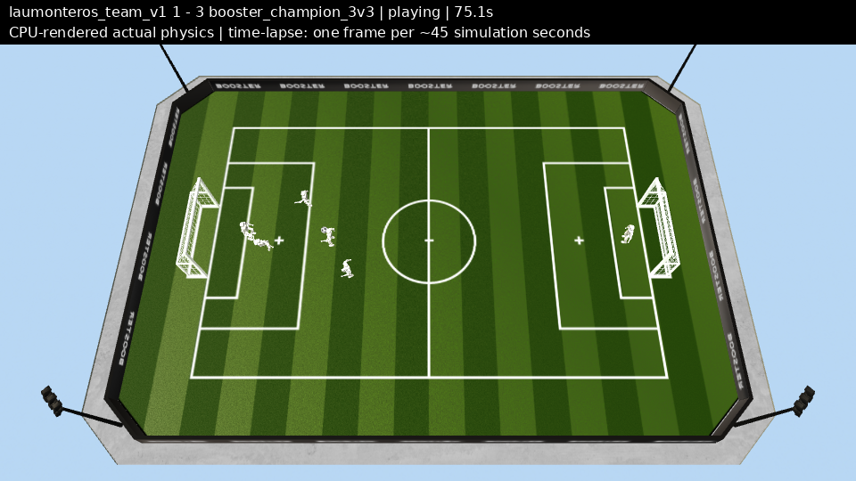

# Keeper v2 acceptance benchmark

Evaluated strategy: **`2f42036523237ed9f1c2dfb9eea6b0f570de28f7`** on
`devin/keeper-v2`, with tracing **off**. Eight fresh games against the official
sample, four home/four away, two workers. No tuning or replacements during this
acceptance batch. Every game finished naturally after 600 regulation simulation
seconds (`time_expired`); no startup failures.

Scores are **home–away**, not always ours first. Fouls and fallen penalties are
**ours/opponent**; warnings count the whole match. Fall penalties are not all
physical falls.

| Match | Our side | Score H–A | GF | GA | Result | Fouls | Warnings | Fallen penalties | Wall seconds |
|---|---|---|---:|---:|---|---|---:|---|---:|
| 01 | home | 1–3 | 1 | 3 | loss | 2/4 | 4 | 1/1 | 1047.5 |
| 02 | away | 3–2 | 2 | 3 | loss | 0/0 | 0 | 0/0 | 980.1 |
| 03 | home | 2–4 | 2 | 4 | loss | 0/0 | 0 | 0/0 | 899.8 |
| 04 | away | 4–0 | 0 | 4 | loss | 0/0 | 1 | 0/0 | 925.6 |
| 05 | home | 3–4 | 3 | 4 | loss | 0/0 | 0 | 0/0 | 899.8 |
| 06 | away | 4–1 | 1 | 4 | loss | 0/0 | 0 | 0/0 | 903.8 |
| 07 | home | 2–3 | 2 | 3 | loss | 1/0 | 1 | 1/0 | 841.9 |
| 08 | away | 4–2 | 2 | 4 | loss | 1/1 | 1 | 0/0 | 842.0 |

```text
BATCH COMPLETE: 8/8 finished; W/D/L=0/0/8
```

## Baseline comparison

Compare rates, not raw totals across different numbers of games.

| Candidate | Games | GF | GA | GF/game | GA/game | Home GA/game | Away GA/game |
|---|---:|---:|---:|---:|---:|---:|---:|
| Historical team-v1 batch-03 | 4 | 13 | 18 | 3.25 | 4.50 | 4.50 | 4.50 |
| Fresh traced keeper baseline | 4 | 9 | 22 | 2.25 | 5.50 | 5.00 | 6.00 |
| Selected v2 tuning round 3 | 4 | 11 | 11 | 2.75 | 2.75 | 2.00 | 3.50 |
| **Default-off v2 acceptance** | **8** | **13** | **29** | **1.625** | **3.625** | **3.50** | **3.75** |

Acceptance conceded **19.4% fewer goals/game** than the 18-in-4 historical
baseline and **34.1% fewer** than the 22-in-4 diagnostic baseline (equivalent
eight-game baseline totals: 36 and 44 GA). However, it lost all eight games,
scored less per game than either baseline, and did not reproduce tuning round
3's 3W/1L or 2.75 GA/game. These unseeded small samples support a lower observed
concession rate, not a reliable win-rate improvement or causal proof. Capture
also adds CPU load to match 01. No acceptance strategy changes were made.

Our four penalties were on roamers: player 2 illegal positioning and player 3
fallen in match 01, player 3 fallen in match 07, and player 2 defender set-play
interference in match 08. No keeper penalty was recorded. Default-off capture
does not provide continuous keeper posture or per-goal diagnostic traces.

Historical baseline details: [team-v1 summary](../team-v1/SUMMARY.md).
The traced baseline and tuning data remain externally under
`~/booster-studio/results/keeper-v2-{baseline,round1,round2,round3}/`;
their combined per-goal report is `~/booster-studio/results/KEEPER-V2-EVALUATIONS.md`.

## Keeper behavior

Keeper-only v2 uses compressed ball-to-goal-centre angle positioning, filtered
observation-derived velocity and goal-mouth interception. A slow/reachable/front
ball gate restricts clearing; walking cancels unsafe kick tasks. Short upfield-facing
waypoints and threat-aware bounded shuffle replace pure ball-y tracking.
Commands stay inside the posts with a safe backstop, but physical overshoot is
still possible. Trace logging remains available and defaults off. Roamers,
set plays and SDK/framework code were not changed. See [strategy](../../team/STRATEGY.md).

## Captured evidence

Match 01 was captured from actual simulator physics at approximately one frame
per 45 regulation seconds. The **[42-second MP4](evidence/match-timelapse.mp4)**
holds each of its 14 frames for three seconds (960×540, H.264, 507,076 bytes).
It is small enough to retain in Git. It is a time-lapse, not continuous footage;
there is no interpolated action. [Frame timestamps](evidence/frames.json) retain
the physics time, regulation clock and score.

| Screenshot | Clock remaining | Interpretation |
|---|---:|---|
| [Kickoff](evidence/kickoff.png) | 599.7 s | Initial play, 0–0 |
| [Keeper defensive position](evidence/keeper-defensive-position.png) | 75.1 s | Goal-area positioning with nearby players, 1–3 |
| [Final](evidence/final.png) | 0.0 s | Completed game, 1–3 |



The images were visually inspected. Sparse sampling cannot establish a specific
keeper save/contact, so the defensive screenshot is **not claimed as a save**.
The original WebP, raw frames and runtime logs remain outside Git.

## Reproduce and provenance

Initialize the Studio-created prepared runtime as documented in `NOTES.md`.
From the repository root, using the default-off package built from `2f42036`:

```bash
python3 scripts/run_team_batch.py \
  --package "$HOME/booster-studio/keeper-v2.agent" \
  --batch keeper-v2-final --matches 8 --workers 2 --base-port 39200 \
  --output "$HOME/booster-studio/results" \
  --work "$HOME/booster-studio/runs"
```

Capture is enabled by omitting `--no-capture`. A rerun needs a new batch name.
The package SHA-256 is
`fc75b5048ce0a8226f373c9544cafb2ded4d0fbc3f495b33a91b983ad3158599`.
All evaluated Python source hashes match commit `2f42036`; the package's strategy
files also match the retained source snapshot, including the default-off flag.

The [batch folder](keeper-v2-final/) retains all eight authoritative results,
contiguous event timelines, summaries, provenance, source snapshot and harness
output. Full external results are `~/booster-studio/results/keeper-v2-final/`;
runtime logs/raw frames are `~/booster-studio/runs/keeper-v2-final/`.
MP4 conversion used `ffmpeg -framerate 1/3` on the numbered raw PNGs with
`libx264 -crf 23 -r 24 -pix_fmt yuv420p -movflags +faststart`.

Validation output:

```text
PASS: 8 final 600s time_expired matches, 4 home/4 away, official opponent, contiguous events, scores and summaries agree
PASS: default-off package hash and all Python source hashes match evaluated commit 2f42036
```
